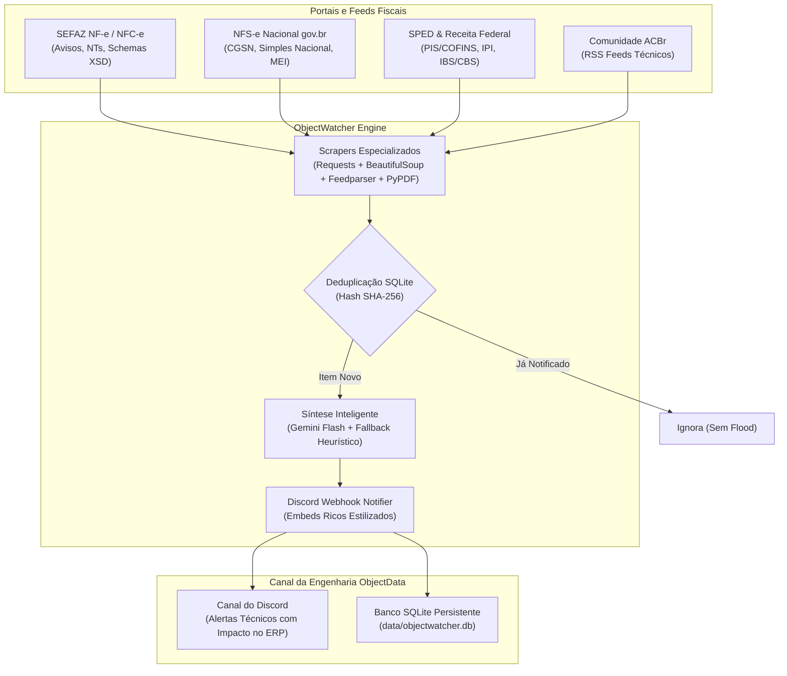

# ObjectWatcher 🛰️ — Monitor Fiscal Inteligente da ObjectData

O **ObjectWatcher** é uma solução de arquitetura de software e engenharia de integrações fiscais desenvolvida para a **ObjectData**. O sistema monitora de forma proativa portais governamentais, repositórios de notas técnicas e feeds da comunidade fiscal brasileira, sintetizando mudanças normativas via Inteligência Artificial (Google Gemini) e despachando alertas estruturados em tempo real para o canal do Discord da equipe de engenharia do ERP.

---

## 🏛️ 1. Portais e Escopo Monitorado

| Módulo / Fonte | O que monitora | Impacto no ERP |
| :--- | :--- | :--- |
| **SEFAZ / Portal Nacional da NF-e** | Notas Técnicas (NTs), Pacotes de Schemas XML (`.xsd`), Informes Técnicos e Avisos do ENCAT | Mudanças de layout (Mod 55 e 65), novos campos e regras de validação/rejeição impeditivas. |
| **Portal Nacional da NFS-e (gov.br/nfse)** | Notícias oficiais, resoluções do Comitê Gestor (CGSN), regras do Simples Nacional/MEI e releases da NT 009 e 010 | Padrão nacional de NFS-e, APIs municipais e regras de transição. |
| **SPED & Receita Federal** | Destaques do Portal SPED, tabelas de alíquotas de PIS/COFINS, IPI, EFD, ECF e transição da Reforma Tributária (IBS/CBS) | Parâmetros fiscais, tabelas de tributação, NCMs e obrigações acessórias. |
| **Comunidade Dev Fiscal (Fórum ACBr)** | Feeds RSS de Notícias Fiscais e Legislação Tributária | Antecipação de falhas em webservices estaduais e discussões técnicas antecipadas. |

---

## 🏗️ 2. Arquitetura da Solução



---

## 🎨 3. Padrão Visual dos Embeds no Discord

As mensagens enviadas no Discord seguem rigorosamente a identidade visual e o formato exigido para desenvolvedores de ERP:

* **Nome do Bot:** `ObjectWatcher`
* **Avatar:** Logotipo da empresa (definido via `Foto_perfil.jpg` ou URL pública).
* **Anexo Direto no Discord:** O PDF da Nota Técnica ou ZIP dos Schemas XML é baixado e **anexado diretamente na mensagem do Discord**. Fica arquivado no servidor do Discord na data exata do envio, permitindo que os desenvolvedores abram o PDF ou baixem o pacote XML sem depender de links governamentais externos.
* **Arquivo Local Automatizado:** Além do Discord, o bot cria automaticamente uma pasta datada em `downloads/YYYY-MM-DD/` contendo os arquivos baixados.
* **Cores Temáticas:**
  * 🔴 **Vermelho (`#E74C3C`):** Urgente (novas rejeições impeditivas, paradas de serviço, mudanças imediatas de schema).
  * 🟠 **Laranja (`#E67E22`):** Atenção (novas Notas Técnicas publicadas, prazos futuros de homologação/produção).
  * 🔵 **Azul (`#3498DB`):** Informativo (comunicados institucionais, manuais e esclarecimentos).

### Estrutura Obrigatória do Embed:
```markdown
🚨 [NF-e / NFC-e] NT 2026.008 v1.01 - Criação do Valor Líquido

Resumo Executivo:
Divulga a criação de campos específicos para o valor líquido do produto na NF-e e NFC-e. 
Define novas validações e ajustes no layout para adequação à Reforma Tributária do Consumo.

🏢 Regimes Afetados:
Simples Nacional, Lucro Presumido, Lucro Real e MEI.

🏷️ Campos & Tags XML (.xsd):
Grupo I (Produtos e Serviços), Grupo NB (ICMS Previsto) e Grupo W (Totais da NF-e).

⚠️ Regras de Rejeição (Impacto na Emissão):
Contém novas regras de validação cadastral e consistência dos valores líquidos informados.

📅 Prazos & Vigência:
Homologação: 16/11/2026 | Produção: 16/11/2026

🔗 Link Oficial / Download:
[Acessar Conteúdo no Portal Oficial](https://www.nfe.fazenda.gov.br/...)
```

---

## 🚀 4. Instalação e Execução Local

### Pré-requisitos
* Python 3.10 ou superior instalado.

### Passo 1: Clonar e instalar dependências
```powershell
# No terminal do Windows (PowerShell):
cd "C:\Users\Felipe Men\Documents\ObjectWatcher"

# Instalar as bibliotecas requeridas
py -m pip install -r requirements.txt
```

### Passo 2: Configurar variáveis de ambiente
Copie o arquivo `.env.example` para `.env` (ou edite o `config.yaml`):
```powershell
cp .env.example .env
```
Preencha as seguintes chaves no seu `.env`:
```env
# URL do Webhook do Discord gerado no canal da sua equipe
DISCORD_WEBHOOK_URL=https://discord.com/api/webhooks/SEU_ID/SEU_TOKEN

# Chave gratuita da API do Google Gemini (Google AI Studio)
# Obtenha em: https://aistudio.google.com/app/apikey
GEMINI_API_KEY=sua_chave_gemini_aqui

# Modelo Gemini (Padrão de alta velocidade e precisão)
GEMINI_MODEL=gemini-3.8-flash

# Nome e Avatar
DISCORD_BOT_NAME=ObjectWatcher
DISCORD_AVATAR_URL=https://raw.githubusercontent.com/sua-empresa/objectwatcher/main/Foto_perfil.jpg
```

> **Nota:** Caso você ainda não possua uma `GEMINI_API_KEY`, o bot ativará automaticamente o **motor heurístico e determinístico local**, garantindo que as notícias continuem sendo mineradas, categorizadas e enviadas sem interrupções!

---

## 🖥️ 5. Execução Silenciosa em Segundo Plano (Sem Janelas Abertas)

Criamos atalhos prontos de **1 clique** na pasta do projeto para você rodar sem nenhuma janela preta aberta na sua área de trabalho:

| Arquivo | Função |
| :--- | :--- |
| **`iniciar_segundo_plano.bat`** | Inicia o ObjectWatcher de forma 100% invisível em segundo plano. Não abre nenhuma janela do prompt e checa os portais a cada 60 minutos. |
| **`verificar_status.bat`** | Abre uma janela rápida mostrando se o bot está `[ONLINE]` (com o PID) e as últimas linhas de log, fechando ao teclar qualquer botão. |
| **`parar_segundo_plano.bat`** | Encerra o processo do monitor em segundo plano com segurança. |
| **`agendar_tarefa_windows.bat`** | Cadastra o monitor no Agendador de Tarefas do Windows para rodar a cada 1 hora (0% de uso de RAM enquanto aguarda e inicia sozinho com o Windows). |

---

## 🛠️ 6. Comandos da Interface de Linha de Comando (CLI)

| Comando | Descrição |
| :--- | :--- |
| `py main.py --test-discord` | Dispara um Embed de teste no Discord para validar se o Webhook está operando. |
| `py main.py --dry-run` | Executa todos os scrapers e simula a IA sem enviar para o Discord nem alterar o banco. |
| `py main.py --run-once` | Executa um único ciclo de monitoramento e encerra (ideal para Cron e GitHub Actions). |
| `py main.py --loop --interval 60` | Executa continuamente em segundo plano checando a cada 60 minutos. |
| `py main.py --stats` | Mostra no terminal quantas publicações foram registradas por fonte e por nível de urgência. |
| `py main.py -v` | Executa exibindo logs detalhados de depuração (`DEBUG`). |

---

## ⏰ 6. Agendamento Periódico (A cada 1 hora)

Você pode rodar o **ObjectWatcher** automaticamente a cada 1 hora utilizando qualquer um dos métodos abaixo:

### Método A: GitHub Actions (100% Gratuito na Nuvem)
O repositório já inclui um workflow pronto em [`.github/workflows/monitor.yml`](.github/workflows/monitor.yml):
1. Faça o push do projeto para um repositório no GitHub.
2. No GitHub, acesse: **Settings** > **Secrets and variables** > **Actions** > **New repository secret**.
3. Adicione os seguintes segredos:
   * `DISCORD_WEBHOOK_URL`: A URL do seu webhook do Discord.
   * `GEMINI_API_KEY`: Sua chave de API do Google Gemini.
4. O GitHub Actions executará o monitor a cada 1 hora (`cron: '0 * * * *'`), mantendo o banco SQLite de deduplicação sincronizado via cache.

---

### Método B: Servidor Linux via Cron (`crontab`)
Se você possui um servidor ou VPS (Ubuntu/Debian/CentOS):
1. Clone o repositório no servidor (ex: `/opt/objectwatcher`).
2. Crie e ative um ambiente virtual:
   ```bash
   cd /opt/objectwatcher
   python3 -m venv venv
   source venv/bin/activate
   pip install -r requirements.txt
   ```
3. Abra a edição do Cron:
   ```bash
   crontab -e
   ```
4. Adicione a linha para executar no início de cada hora:
   ```cron
   0 * * * * cd /opt/objectwatcher && /opt/objectwatcher/venv/bin/python main.py --run-once >> /var/log/objectwatcher.log 2>&1
   ```

---

### Método C: Docker & Docker Compose
Para rodar como um serviço conteinerizado autônomo:
```bash
# Iniciar o container em segundo plano
docker compose up -d --build

# Visualizar logs em tempo real
docker compose logs -f
```
O arquivo [`docker-compose.yml`](docker-compose.yml) monta o volume local `./data:/app/data`, garantindo que o histórico do SQLite sobreviva a qualquer reinicialização do container.

---

### Método D: Agendador de Tarefas do Windows (Windows Task Scheduler)
Para executar em um servidor Windows ou máquina local:
1. Pressione `Win + R`, digite `taskschd.msc` e pressione Enter.
2. Clique em **Criar Tarefa Básica...**
3. Nomeie como `ObjectWatcher Fiscal Monitor`.
4. Disparador: **Diariamente** > Repetir a cada **1 hora**.
5. Ação: **Iniciar um programa**.
   * Programa/script: `py.exe` (ou o caminho completo do seu `python.exe`).
   * Adicionar argumentos: `main.py --run-once`
   * Iniciar em: `C:\Users\Felipe Men\Documents\ObjectWatcher`
6. Clique em **Concluir**.

---

## 🛡️ 7. Mecanismos de Robustez e Tolerância a Falhas

1. **Deduplicação Criptográfica:** Cada publicação gera um hash `SHA-256` normalizado com base no link oficial ou identificador único. Publicações idênticas nunca são enviadas duas vezes.
2. **Download e Análise de PDFs:** Quando a SEFAZ publica uma nova Nota Técnica em PDF, o sistema faz o download das primeiras páginas e extrai o texto com `pypdf`, permitindo que a IA identifique grupos XML como `<vLiq>` e regras de rejeição mesmo antes de manuais consolidados serem lançados.
3. **Respeito aos Rate Limits do Discord:** O despachador trata automaticamente respostas HTTP 429 (`Retry-After`), evitando qualquer banimento do Webhook.
4. **Gerenciamento de Cookies ASP.NET da SEFAZ:** O scraper inicializa uma sessão que absorve os cookies de redirecionamento do portal da fazenda, contornando o erro comum de HTTP 302 que afeta scrapers genéricos.

---

## 👥 Suporte e Equipe
Desenvolvido com excelência técnica para o time de Integrações Fiscais e ERP da **ObjectData**.
Em caso de dúvidas ou sugestões de novos portais estaduais, abra uma issue ou contate a equipe interna.

